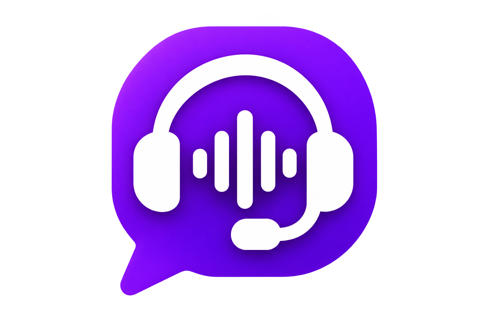

<p align="center">
  
</p>

<h1 align="center">Disc Voice</h1>

<p align="center">
  <strong>Seu espaço para amigos e comunidades.</strong><br />
  Crie servidores, converse por canais de texto e cuide do seu áudio e vídeo —<br />
  tudo em português e direto no seu Windows.
</p>

<p align="center">
  <a href="https://github.com/gabrielmelogm/disc-voice/releases"></a>
  <a href="DOCS.md"></a>
  <a href="https://github.com/gabrielmelogm/disc-voice/issues/new"></a>
</p>

<p align="center">
  
  
  
  
  
  
</p>

---

## 🎧 Um lugar para a sua comunidade

O **Disc Voice** reúne contas, servidores com convites, canais de texto e ferramentas
de voz e vídeo em um aplicativo desktop feito com **Tauri 2, React, TypeScript e Rust**.
A interface é toda em português e o áudio nativo usa **WASAPI/CPAL** para funcionar de
verdade com seus dispositivos.

| | |
|:--|:--|
| 👤 **Contas e sessões** | Cadastro com e-mail e senha protegida por **Argon2id**. Sessão revogável de até sete dias. |
| 🏠 **Servidores e convites** | Crie seu servidor, compartilhe um convite e entre em comunidades pelo link ou pelo app. |
| 💬 **Canais de texto** | Crie, liste e selecione canais. Os nomes são únicos dentro de cada servidor e ficam salvos no PostgreSQL. |
| 🎙️ **Microfone** | Teste a entrada, veja o pico capturado e o nível em **dBFS** antes de entrar em uma conversa. |
| 🔊 **Saída de áudio** | Toque um tom de 440 Hz na saída escolhida e ouça a última gravação no mesmo dispositivo. |
| 📷 **Webcam** | Prévia com resolução, taxa de quadros e opção de espelhamento, com permissões tratadas no WebView2. |

> [!NOTE]
> 🚧 **Em desenvolvimento:** o envio e o histórico de mensagens nos canais são a próxima etapa.
> Hoje já é possível criar, persistir, listar e selecionar canais normalmente.

---

## 🖥️ Plataformas e instalação

**Versão atual:** `0.1.0`

| Plataforma | Instalação | Disponibilidade |
|:--|:--|:--|
| **Windows 10/11 (x64)** | Instalador **`.exe` (NSIS)** | ✅ App completo |
| **Web** | Nenhuma — abra no navegador | ✅ Mesma conta e servidores |
| **Linux / macOS** | Nenhuma — use a versão web | ⚠️ Sem aplicativo nativo |

> [!IMPORTANT]
> O aplicativo desktop é exclusivo para **Windows 10/11 de 64 bits**. O áudio nativo
> (**WASAPI/CPAL**) e a integração completa com microfone, saída e webcam só funcionam
> na versão instalada para Windows. Em outros sistemas, use a versão web.

### Instalar no Windows

1. **Baixe o instalador** `Disc Voice_0.1.0_x64-setup.exe` na página de
   [Releases](https://github.com/gabrielmelogm/disc-voice/releases). Se ainda não houver
   uma release publicada, baixe o artefato **`disc-voice-windows`** na execução mais recente
   do workflow [Windows](https://github.com/gabrielmelogm/disc-voice/actions/workflows/windows.yml).
2. **Execute o `.exe`** e siga o assistente de instalação. O WebView2 é baixado
   automaticamente caso ainda não esteja presente.
3. **Abra o Disc Voice**, crie sua conta e comece a montar sua comunidade.

O instalador também pode ser gerado localmente:

```powershell
npm ci
npm run build:windows
```

O arquivo final fica em `target/release/bundle/nsis/`. Os requisitos completos de
desenvolvimento estão na [documentação](DOCS.md#executar-no-windows).

### Usar a versão web

Com Docker e Node.js instalados, na raiz do projeto:

```powershell
Copy-Item .env.example .env
npm ci
npm run services:up
```

Depois abra **<http://localhost:3001>**. No Linux, use `cp .env.example .env`.
A versão web compartilha a mesma API, contas, servidores e canais do aplicativo desktop.

---

## 🐞 Encontrou um bug?

Toda ajuda é bem-vinda! Antes de abrir uma issue:

- 🔍 Procure nas [issues existentes](https://github.com/gabrielmelogm/disc-voice/issues)
  para evitar relatos duplicados.
- ⬆️ Confirme se o problema acontece na versão mais recente (**0.1.0**).
- 🧪 Se possível, tente reproduzir o bug mais de uma vez.

### Como abrir uma issue

1. Acesse **[Nova issue](https://github.com/gabrielmelogm/disc-voice/issues/new)**.
2. Use um título claro e descritivo, como `[Bug] Microfone não aparece após conectar via USB`.
3. Descreva o que aconteceu com o máximo de detalhes: passos para reproduzir, comportamento
   esperado e comportamento atual.
4. Informe a **versão do Disc Voice** (`0.1.0`), a versão do Windows, o modelo do
   microfone, da saída de áudio ou da webcam quando o problema for relacionado a dispositivos.
5. Anexe prints, vídeos ou logs que ajudem a entender o problema.
6. Clique em **Submit new issue** e acompanhe as respostas.

Você pode copiar este modelo para o corpo da issue:

```markdown
## Descrição do bug
Uma descrição curta e clara do que aconteceu.

## Como reproduzir
1. Abra o Disc Voice
2. Vá em '...'
3. Clique em '...'
4. Veja o erro

## Comportamento esperado
O que deveria ter acontecido.

## Comportamento atual
O que realmente aconteceu.

## Ambiente
- Versão do Disc Voice: 0.1.0
- Windows: 10/11 (build)
- Microfone/saída/webcam (se aplicável):
- Versão instalada ou versão web:

## Evidências
Prints, vídeos ou logs relevantes.
```

> [!WARNING]
> Nunca inclua **senhas**, **tokens de sessão**, **códigos de convite** ou outros dados
> pessoais na issue. Essas informações são sensíveis.

Sugestões e ideias de novas funcionalidades também são bem-vindas na
[página de issues](https://github.com/gabrielmelogm/disc-voice/issues).

---

## 📚 Documentação

| Documento | Conteúdo |
|:--|:--|
| 📖 [DOCS.md](DOCS.md) | Guia completo de contas, servidores, canais, convites e banco de dados |
| 🎙️ [Testes de dispositivos](DOCS.md#testes-de-dispositivos) | Microfone, saída de áudio e webcam na prática |
| 🪟 [Executar no Windows](DOCS.md#executar-no-windows) | Requisitos, desenvolvimento e geração do instalador |
| 🐧 [WSL ou Linux](DOCS.md#desenvolvimento-no-wsl-ou-linux) | Como rodar a API e a versão web |
| 🧪 [Testes automatizados](DOCS.md#desenvolvimento-e-testes-automatizados) | Comandos de verificação e testes da API |
| 🏗️ [Estrutura](DOCS.md#estrutura) | Organização do monorepo, API, desktop e motor de áudio |

---

<p align="center">
  
  <br />
  <sub><strong>Disc Voice</strong> · versão 0.1.0 · feito com Tauri, React, Rust e TypeScript</sub><br />
  <sub>Projeto independente, sem vínculo com o Discord.</sub>
</p>
